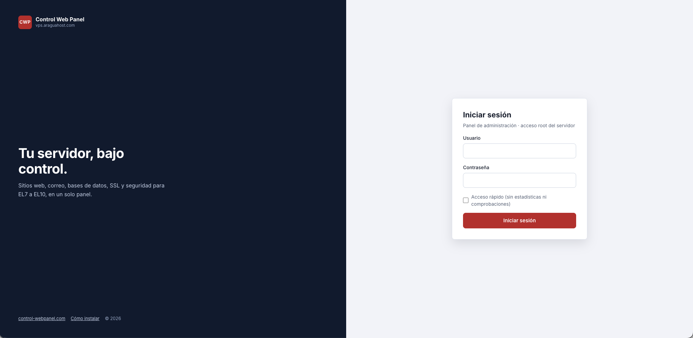
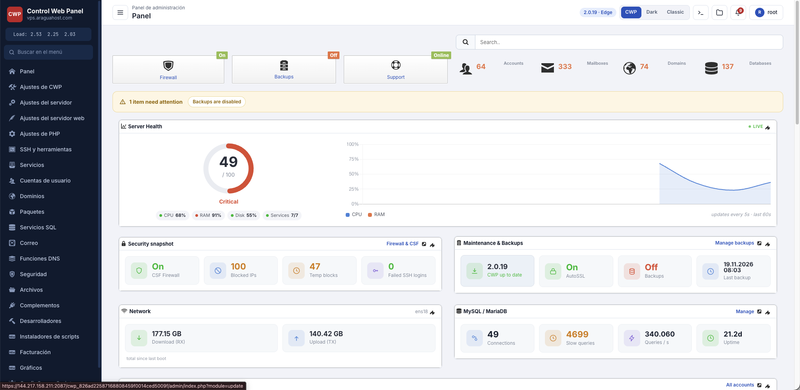

Control Web Panel (CWP) is a free, open-source hosting control panel for Linux. It installs a complete hosting stack on a single server: Nginx and Apache with Varnish caching, multiple PHP versions, mail with Postfix and Dovecot, DNS with BIND or PowerDNS, FTP, Let's Encrypt certificates, per-account backups, a cPanel account migration tool and a REST API. CWP does not charge a licence fee at any scale.

## Deploying a CWP Marketplace App

1.  Log in to the [Linode Cloud Manager](https://cloud.linode.com) and select **Create** > **Linode**.
2.  In the **Select an Image** step, open the **Marketplace** tab and choose **Control Web Panel**.
3.  Choose a region and a plan. CWP needs **at least 2 GB of RAM and 20 GB of disk**; 4 GB of RAM is recommended for hosting more than a couple of sites.
4.  Set a **limited sudo user** and password policy. This user receives the root account's SSH keys.
5.  Optionally, provide a domain and an API token so the deployment creates the DNS record, and choose whether to disable root login over SSH.
6.  Click **Create Linode** and wait for the deployment to finish. The installer takes **10 to 20 minutes**; the Linode boots into a working panel, no terminal input is required.

**Required distribution:** AlmaLinux 9.

**Suggested plan:** a 4 GB shared or dedicated plan (for example `g6-standard-2`).

## Accessing the panel

1.  Connect to the Linode over SSH as the limited sudo user:
    ```bash
    ssh <username>@<linode-ip>
    ```
2.  Read the generated credentials:
    ```bash
    cat ~/.credentials
    ```
    The file contains the sudo user password, the panel URL, the admin username (`root`) and its password, and the MariaDB root password.
3.  Open the panel in a browser:
    - `https://<linode-ip>:2031` (secure) or `http://<linode-ip>:2030`
    - Accept the self-signed certificate warning on first access.
4.  Log in with **root** and the password from `~/.credentials`, then complete the first-run wizard (nameservers, email and panel settings).



After logging in, the panel dashboard shows the server health, the services running, the number of hosting
accounts, mailboxes and domains, along with the firewall and backup state.



## Limited user fields

This app follows the Marketplace limited user requirements: a non-root sudo user is created, the root account's SSH keys are copied to it, and root SSH access can be disabled at deployment time. See the [Marketplace required limited user fields guide](https://github.com/linode/docs/blob/develop/docs/products/tools/marketplace/_shortguides/marketplace-required-limited-user-fields-shortguide/index.md).

## Notes

-   **Mail:** the panel configures Postfix and Dovecot. Outbound port 25 must be open on the account for mail delivery, and a reverse DNS record matching the Linode hostname is required by most receivers.
-   **DNS:** the deployment can create the A record in the Linode DNS manager when an API token and domain are supplied; otherwise the panel manages its own DNS zones.
-   **SELinux:** the app sets SELinux to permissive, which CWP requires for its services.
-   **Firewall:** firewalld is enabled with the panel, web, mail, DNS and FTP ports open.
-   **Logs:** the installer output is kept in `/root/cwp-install.log`.

## More information

-   [CWP installation instructions](https://control-webpanel.com/installation-instructions)
-   [CWP support portal](https://support.centos-webpanel.com/)
